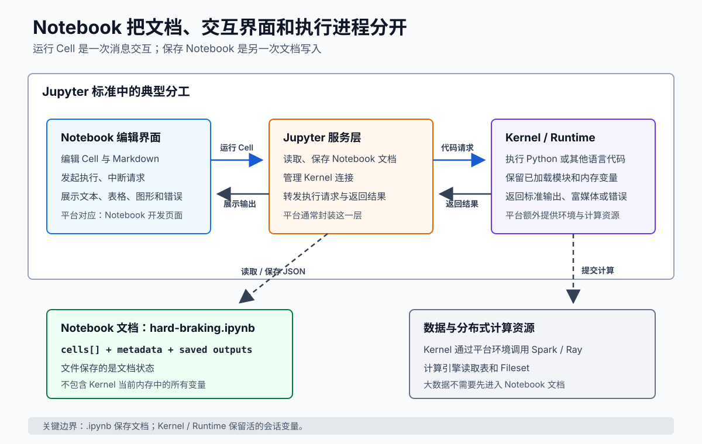

# 📌 为什么需要 Notebook：从脚本到交互式计算

同一条急减速规则完全可以写成 `hard_braking.py`。输入字段、阈值和输出格式已经明确时，脚本从固定入口完整运行，很适合代码评审、自动测试和重复调度。

规则刚开始探索时，工程师会反复更换样本、打印中间表、调整阈值，还要记录“为什么这样改”。Notebook 把代码分成可单独执行的 Cell，让已加载的样本留在 Runtime 中，并把说明、代码和输出放在同一份文档里。它缩短了“提出问题 → 运行一段 → 观察结果 → 修改问题”的循环。

学完本篇，你应该能根据任务是在探索还是已经稳定，选择 Notebook、Python 脚本或两者配合；也能在关闭页面、保存文件、断开 Runtime 和重启 Runtime 四种操作中，判断代码、输出和变量状态分别是否还存在。

## 📄 Notebook 从交互式计算演化而来

命令行中的 REPL 已经能完成“输入一句、执行一句、返回结果”。IPython 在 Python REPL 上增加了更适合科学计算和数据探索的交互能力。Jupyter 后来把这种工作方式拆成可协作的几个标准部件：

| 部件 | 责任 | 在本教程中对应什么 |
| --- | --- | --- |
| Notebook 文档格式 | 用 JSON 记录 Cell、源码、元数据和已保存输出 | `.ipynb` 文件 |
| Notebook 编辑界面 | 编辑 Cell、发起执行、展示输出 | 数据工场的 Notebook 开发页面 |
| Jupyter 服务层 | 读写文档，在界面与 Kernel 之间传递消息 | 通常由平台封装，使用者不一定直接看到 |
| Kernel | 执行某种语言的代码，保留进程内变量，返回输出或错误 | Python Kernel；在集团平台中由 Runtime 提供执行环境和资源 |

Jupyter 的关键技术选择是把“文档”、“交互界面”和“执行进程”分开。点击运行 Cell 时，编辑界面把代码作为执行请求发给 Kernel；Kernel 在长时间存活的进程中执行，再把标准输出、表格、图形或错误返回界面。保存 Notebook 时，界面才把选定的输出与 Cell 源码写入 `.ipynb`。

<div style="overflow-x: auto;">
  
</div>

[打开 SVG 原图](assets/notebook-standard-architecture.svg)

集团平台会封装服务层、认证、远程资源和 Spark/Ray 连接。封装后的页面名称可能不同，但“文件保存什么”和“进程保留什么”这条边界仍然是理解状态问题的基础。

## 📄 普通 Python 脚本什么时候更合适

| 任务特征 | 建议载体 | 原因 |
| --- | --- | --- |
| 问题和口径还在变，需要频繁查看中间结果 | Notebook | Cell 缩短反馈循环，说明、代码和结果可以就地对照 |
| 输入、参数和输出契约已经稳定 | Python 脚本 | 固定入口、线性执行和文本 diff 更利于自动化 |
| 核心规则要被多个任务复用 | Python 模块加测试 | 函数和类可独立版本化、测试和发布 |
| 既要在样本上解释结果，又要复用稳定规则 | 薄 Notebook 加 Python 模块 | Notebook 保留参数、展示和调用，模块保留业务逻辑 |

因此，“能否用 Python 脚本完成”不是选型分界。这两种载体都能执行 Python；选型要看当前更需要交互反馈，还是稳定入口、测试和复用。如果平台同时支持脚本作业，已经稳定的纯批处理任务可以直接选脚本，无需为了发布而强行套一层 Notebook。

## 📄 Notebook 文件保存什么

一个 `.ipynb` 文件由多个 Cell 组成，常见 Cell 有三类：

| Cell | 责任 | 急减速案例中的内容 |
| --- | --- | --- |
| Python | 执行 Python 语句 | 定义阈值、过滤事件、写出 CSV |
| SQL | 让查询引擎执行 SQL | 按日期读取车辆事件表 |
| Markdown | 保存解释性文字 | 记录规则口径和验证结论 |

`.ipynb` 实际上是 JSON 文档。它能够保存 Cell 的源码、顺序、类型以及部分输出。编辑页面负责读写这个文件，计算资源由 Runtime 提供。

可以把它映射到熟悉的工程概念：

| Notebook 概念 | 接近的工程经验 | 关键差异 |
| --- | --- | --- |
| Notebook 文件 | 一个带源码和运行记录的工程文档 | Cell 可以按任意顺序执行 |
| Cell | 可单独调用的代码片段 | 它直接读写当前会话的全局变量 |
| Runtime | 长时间存活的进程加计算资源 | 多个 Cell 共享同一份进程状态 |
| 运行全部 | 从顶部重新执行一遍入口流程 | 单独运行 Cell 不保证遵守这个顺序 |

## 📄 只补本教程需要的 Python

先看一段可以放进 Python Cell 的代码：

```python
event_date = "2026-08-12"
threshold_kmh = 20

events = [
    {"event_id": "E101", "speed_before_kmh": 72, "speed_after_kmh": 42},
    {"event_id": "E102", "speed_before_kmh": 50, "speed_after_kmh": 41},
]

def speed_drop(event):
    return event["speed_before_kmh"] - event["speed_after_kmh"]

candidates = [event for event in events if speed_drop(event) >= threshold_kmh]
print(f"{event_date}: {[event['event_id'] for event in candidates]}")
```

输出：

```text
2026-08-12: ['E101']
```

与几门编译型语言对照：

| Python 写法 | Java / Rust / Go / C++ 心智模型 |
| --- | --- |
| `x = 20` | 创建或重新绑定变量，类型由运行时值决定 |
| `{"event_id": "E101"}` | 类似 `Map<String, Object>`，这里称字典 `dict` |
| `[a, b]` | 类似 `List`、`Vec` 或 slice，称列表 `list` |
| `def speed_drop(event):` | 定义函数；缩进表示函数体范围 |
| `f"date={event_date}"` | 类似 Java 模板格式化或 Rust `format!` |
| `[x for x in xs if ...]` | 类似 Stream、Iterator 或 range 的过滤收集 |

Notebook 入门阶段只需要读懂赋值、列表、字典、函数、`import`、`for` 和 `with open(...)`。Python 包和导入的完整机制见 [Python 模块、包与导入机制](../../../../语言基础/python/模块系统/模块、包与导入机制.md)。

## 📄 变量住在 Runtime 中

假设依次运行三个 Cell：

```python
# Cell 1
threshold_kmh = 20
```

```python
# Cell 2
threshold_kmh = 30
```

```python
# Cell 3
print(threshold_kmh)
```

先预测：只看文件从上到下执行，Cell 3 应输出多少？答案是 `30`。

改变执行顺序：先运行 Cell 2，再运行 Cell 1，最后运行 Cell 3。输出会变成 `20`。Runtime 保存的是**实际执行历史形成的状态**，不是编辑器当前从上到下看起来应该得到的状态。

这也是 Notebook 最常见的认知陷阱：代码文本与会话状态可能暂时不一致。验证一份 Notebook 能否重现时，应重启 Runtime，然后执行全部 Cell。

## 📄 Runtime 负责环境和资源

集团 Notebook 页面要求先配置并启动 Runtime，再把 Notebook 连接到运行中的 Runtime。Runtime 主要负责：

- Python、Spark 等基础环境版本。
- Driver、Executor 或 Ray Head/Worker 的 CPU 和内存。
- 已加载模块、变量、临时视图和动态安装依赖形成的会话状态。
- Cell 的排队、执行、中断和结果返回。

平台预先提供 `spark`，使用 PySpark 时不需要手动创建 `SparkSession`，也不要调用 `spark.stop()`。停止 Runtime、会话中断或平台回收资源后，内存变量会消失；已经保存到 `.ipynb` 或外部文件中的内容仍可保留。

## 📄 保存、关闭和重启分别改变什么

| 操作 | `.ipynb` 源码 | 文件内已保存输出 | Runtime 内存变量 |
| --- | --- | --- | --- |
| 保存 Notebook | 保留 | 通常随文件保存 | 不变 |
| 关闭浏览器页面 | 保留 | 保留已保存部分 | Runtime 仍存活时可能继续存在 |
| 断开 Notebook | 保留 | 保留 | Runtime 是否停止由平台状态决定 |
| 停止或重启 Runtime | 保留 | 保留 | 清空，需重新执行 Cell |
| 删除 Notebook 文件 | 删除 | 随文件删除 | 已连接 Runtime 中可能短暂残留，不能依赖 |

边界以平台当前实现为准。集团文档特别指出：目前“中断运行”会中断会话并导致上下文变量丢失。

## 📄 费曼检查

先向同事做一次选型：

> 急减速规则已经稳定，任务只读取日期参数、运行规则并写出 CSV。平台同时支持 Python 脚本作业。你会选什么，选择依据是什么？

脚本通常是更直接的选择。如果团队还需要在页面中留下样本、表格和口径说明，可以保留一份薄 Notebook，由它导入已测试的 Python 模块。

不用“状态”这个抽象词，向一位熟悉 Java 的同事解释：

> 为什么 Git 中的 `.ipynb` 文件完全相同，两个人打开后运行最后一个 Cell，仍可能得到不同结果？

你的解释应该出现三个具体对象：Cell 源码、Cell 的实际执行顺序、Runtime 内存。如果只说“Notebook 不稳定”，请回到[变量住在 Runtime 中](#-变量住在-runtime-中)，逐步重放两种执行顺序。

---

[返回教程目录](README.md) | [下一篇：表、Fileset 与计算引擎](01-表-Fileset-与计算引擎.md)

## 🌳 生长思考

> ⚠️ 此板块由用户本人填写，AI 创建笔记时只保留占位，不填充具体内容。

## 💭 反复绊脚

> ⚠️ 此板块由用户本人填写，AI 创建笔记时只保留占位，不填充具体内容。

## 🗺️ 修订记录

- 2026-08-14：面向编译型语言工程师建立 Notebook、Cell、Runtime 与 Python 最小语法映射。
- 2026-08-17：补充交互式计算背景、Jupyter 组件分工，以及 Notebook 与 Python 脚本的选型边界。

## 🛠️ 实践经历

## ⚙️ prompt

## 调研

- [集团：Notebook 使用指南](https://mi.feishu.cn/wiki/Qk7WwAwPyinAaSkvyhjc8reenzf)
- [Jupyter Notebook 文档格式](https://nbformat.readthedocs.io/en/latest/)
- [Jupyter 架构](https://docs.jupyter.org/en/latest/projects/architecture/content-architecture.html)
- [Jupyter Kernel 消息协议](https://jupyter-client.readthedocs.io/en/latest/messaging.html)
