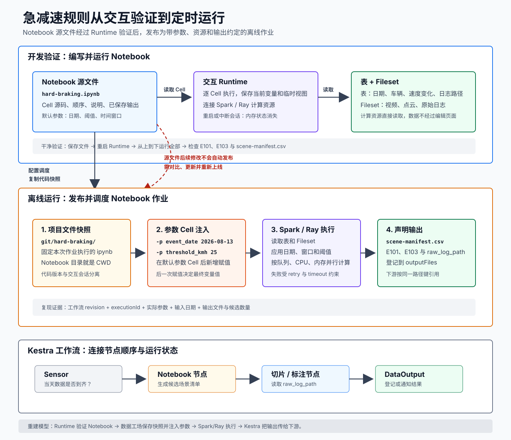

# 📌 用 Notebook 开发并发布智驾数据挖掘任务

智驾数据团队每天都要从车辆事件中筛出值得回放的急减速片段。规则刚开始开发时，工程师需要反复查看样本、调整阈值并核对结果；规则稳定后，同一份计算还要按日期自动运行，并把候选清单交给切片、标注或回放任务。

开发阶段需要一个很短的反馈循环：只运行一段代码，立即查看表格或图形，保留已加载的样本，然后继续调整规则。Notebook 为这个循环提供 Cell、已保存输出和长时间存活的 Runtime。发布后，数据工场保存 Notebook 作业快照，在每次调度时注入参数，交给 Spark 或 Ray 执行，再由 Kestra 工作流连接前后任务。

普通 Python 脚本可以完成同样的计算。当输入、规则和输出已经稳定时，脚本或 Python 模块更容易做代码评审、单元测试和复用。本教程使用 Notebook，是因为场景规则需要先交互验证，再通过集团平台发布；成熟的共享逻辑仍可抽到 `.py` 文件，由 Notebook 负责参数、调用和结果检查。

本教程面向熟悉 Rust、Java、Go 或 C++，但只会运行 Python、没有 Notebook 和大数据平台经验的工程师。学完后，你应该能够：

1. 说明 Notebook 为什么会出现、什么时候普通 Python 脚本更合适，并解释 Notebook 文件、Cell 和 Runtime 的责任。
2. 区分表数据、Fileset 文件和 Notebook 输出文件。
3. 解释配置调度后，Notebook 源文件怎样变成可重复执行的离线作业。
4. 解释 `-p event_date 2026-08-12` 为什么会覆盖参数 Cell，而不是进入 `argv`。
5. 独立运行急减速场景示例，并按证据排查状态、依赖、文件和资源问题。

## 📄 贯穿教程的问题

智驾数据团队需要从一天的车辆事件中找出“2 秒内速度下降至少 20 km/h”的候选片段：

| event_id | event_date | vehicle_id | speed_before_kmh | speed_after_kmh | raw_log_path |
| --- | --- | --- | ---: | ---: | --- |
| E101 | 2026-08-12 | V001 | 72 | 42 | `gvfs://fileset/autodrive/raw/E101/` |
| E102 | 2026-08-12 | V002 | 50 | 41 | `gvfs://fileset/autodrive/raw/E102/` |
| E103 | 2026-08-12 | V003 | 90 | 60 | `gvfs://fileset/autodrive/raw/E103/` |

结构化事件字段适合放在表中，视频、点云和车辆原始日志适合放在 Fileset 中。Notebook 读取事件表，筛出 `E101`、`E103`，再输出一份 `scene-manifest.csv`，供后续切片、标注或回放节点使用。

这里的表名和路径都是教学占位符。进入真实空间后，应从左侧数据管理区选择有权限的表与 Fileset，不要直接照抄示例名称。

## 📄 从验证规则到每天自动运行

开发入口位于“数据工场 > 查询 > Notebook”。工程师在这里创建 Notebook、连接 Runtime，通过少量样本验证急减速规则。当 Notebook 能从头到尾稳定运行后，工程师再配置调度，把它发布到 AI 数据开发。

整条链可以分为两个阶段：

| 阶段 | 工程师的工作 | 平台的工作 | 阶段结果 |
| --- | --- | --- | --- |
| 开发验证 | 编写 Cell、运行样本、核对候选片段 | Runtime 执行代码，Spark/Ray 读取表和 Fileset | 可从头到尾重现结果的 `.ipynb` |
| 离线运行 | 发布代码，设置参数、资源和输出 | 数据工场保存快照，Kestra 按计划调度并传递结果 | 可观测、可重试、可被下游消费的 Notebook 作业 |

<div style="overflow-x: auto;">
  
</div>

[打开 SVG 原图](assets/notebook-to-workflow.svg)

这条链中有三种不同的东西在移动：

- **代码快照**：调试好的 `.ipynb` 被复制到 AI 数据开发，离线作业执行自己的版本。
- **控制参数**：日期、阈值和资源配置进入作业；`-p` 参数通过新 Cell 覆盖默认变量。
- **业务数据**：Spark 或 Ray 直接读取表和 Fileset，数据不会先流过 Notebook 编辑页面。

## 📄 学习路线

| 顺序 | 文档 | 学完后能回答 |
| --- | --- | --- |
| 0 | [为什么需要 Notebook](00-Notebook-Cell-与-Runtime.md) | 普通 Python 脚本什么时候已经够用，Notebook 又为交互探索增加了什么？ |
| 1 | [表、Fileset 与计算引擎](01-表-Fileset-与计算引擎.md) | 事件索引、视频日志和批量计算分别应该交给谁？ |
| 2 | [交互式完成一次场景挖掘](02-交互式场景挖掘.md) | 怎样逐 Cell 验证输入、规则和输出，又不把大数据拉爆 Driver？ |
| 3 | [把 Notebook 发布为离线作业](03-从-Notebook-到离线工作流.md) | 调度创建了什么快照，修改源 Notebook 后为什么还要更新作业？ |
| 4 | [参数 Cell 的注入机制](04-参数-Cell-注入.md) | 默认参数、`Arguments` 和运行时新增 Cell 怎样决定最终变量值？ |
| 5 | [动手实验与生产排查](05-动手实验与生产排查.md) | 怎样跑通示例，并从状态、版本、文件、依赖和资源逐层定位失败？ |

第一遍按 `00` 到 `05` 阅读。遇到 Spark 的 Driver、Executor、DataFrame 或惰性计算不清楚时，转到 [Spark 零基础前置课](../../Spark/费曼教程/00-零基础前置课.md) 和 [SQL、DataFrame 与惰性计算](../../Spark/费曼教程/02-SQL-DataFrame-与惰性计算.md)，再回到当前章节。

## 📄 学习验收

不看原文，画出下面两条链并口述每个箭头传递了什么：

```text
交互调试：工程师运行 Cell -> Runtime 执行代码 -> Spark/Ray 读取数据 -> 工程师检查结果
生产运行：工程师发布 Notebook -> 平台保存作业快照 -> 调度注入参数 -> Spark/Ray 执行 -> 下游读取输出
```

然后回答：

1. 急减速规则已经稳定，只需每天读取日期参数并写出 CSV。如果平台同时支持 Python 脚本作业，还有必要坚持用 Notebook 吗？
2. Notebook 开发页面刚运行出 `E101`、`E103`，定时任务今晚就一定执行这版代码吗？
3. `%pip install pandas` 成功后重启 Runtime，为什么下一次仍可能导入失败？
4. `spark.table(...)` 返回 DataFrame 时，整张事件表是否已经进入 Driver 内存？
5. 作业成功但下游找不到 `scene-manifest.csv`，应该先检查哪两个路径规则？

答案都能从整套教程的机制推出，不需要背结论。

## 🌳 生长思考

> ⚠️ 此板块由用户本人填写，AI 创建笔记时只保留占位，不填充具体内容。

## 💭 反复绊脚

> ⚠️ 此板块由用户本人填写，AI 创建笔记时只保留占位，不填充具体内容。

## 🗺️ 修订记录

- 2026-08-14：根据集团《Notebook 使用指南》《AI数据开发-Notebook作业》和《参数配置文档》建立零基础学习路线。
- 2026-08-14：以急减速任务为主线重写开发、发布与调度过程，统一页面和作业术语。
- 2026-08-17：在学习起点补入 Notebook 的技术背景，明确 Notebook、Python 脚本和 Python 模块的选型边界。

## 🛠️ 实践经历

## ⚙️ prompt

## 调研

- [集团：Notebook 使用指南](https://mi.feishu.cn/wiki/Qk7WwAwPyinAaSkvyhjc8reenzf)
- [集团：AI数据开发-Notebook作业](https://mi.feishu.cn/wiki/NzoRwUNj5iwhomknpk3c3YFMnee)
- [集团：参数配置文档](https://mi.feishu.cn/wiki/BksjwYKrNiSa3MkFwSzcLwKjn8g)
- [Project Jupyter Documentation](https://docs.jupyter.org/en/latest/)
- [Apache Spark SQL 与 DataFrame](https://spark.apache.org/docs/latest/sql-programming-guide.html)
