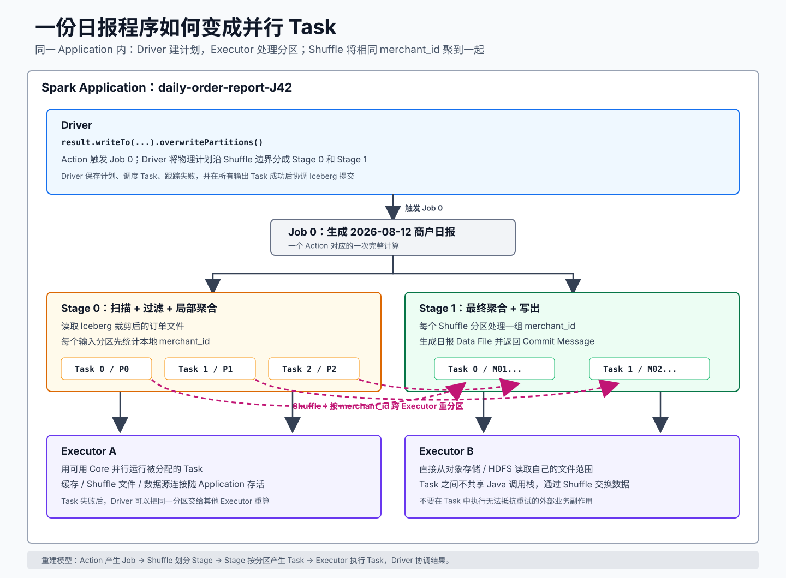

# 📌 一条计算怎样拆成 Task

日报程序只有几行聚合代码，输入却可能由上万个文件组成。Spark 的核心工作是把这份高层计算转成多个可并行、可失败重试的 Task。

每个 Task 可以先过滤并统计自己分区里的订单。执行到 `groupBy(merchant_id)` 时会出现新问题：同一个商户可能散落在多个输入分区，最终汇总必须让它们相遇。Spark 按 `merchant_id` 把中间数据重新送往后续分区，这个**按照 key 跨分区重新分布中间数据**的过程叫 **Shuffle**：

```text
输入分区 0：M01, M02, M01  --\
输入分区 1：M02, M03       ----> 按 merchant_id 重新分区
输入分区 2：M01, M03       --/        |
                                       +-> M01 分区
                                       +-> M02 分区
                                       +-> M03 分区
```

现在再看完整执行层级：前一组 Task 产生 Shuffle 数据，后一组 Task 读取重新分区的数据并完成汇总。

## 📄 先看完整层级

<div style="overflow-x: auto;">
  
</div>

[打开 SVG 原图](assets/spark-execution-model.svg)

从外到内读图：

1. `spark-submit` 启动一次 **Application**。
2. Application 中的 **Driver** 运行 `main` 程序，创建 `SparkSession`，并生成执行计划。
3. `write` 等 Action 触发一个 **Job**。
4. Job 在 Shuffle 边界被分成 **Stage**。
5. 每个 Stage 按分区生成 **Task**，Task 由 **Executor** 进程执行。

## 📄 Driver 和 Executor 怎样分工

### 🔖 Driver

Driver 负责运行用户程序和协调整次计算：

- 解析用户写下的 SQL 或表格转换步骤。
- 优化逻辑计划，选择物理操作。
- 把 Job 拆成 Stage 与 Task。
- 跟踪 Task 成功、失败和重试。
- 协调输出提交。

Driver 保存计划与协调状态，业务数据的主要处理在 Executor 上发生。`collect()` 会主动把结果拉回 Driver；当结果超过 Driver 内存时，Application 会因 Driver 溢出而失败。

### 🔖 Executor

Executor 是集群节点上的进程。它在一次 Application 内反复执行 Task：

- 读取自己负责的文件范围。
- 执行过滤、投影、局部聚合、Join 等操作。
- 写入或读取 Shuffle 中间数据。
- 写出结果 Data File，并把文件信息返回 Driver。

一个 Executor 可以并行运行多个 Task，上限受 Executor Core 数量等资源配置影响。

## 📄 Job、Stage 和 Task

| 对象 | 如何产生 | 本案例中的含义 |
| --- | --- | --- |
| Job | Action 触发一次执行 | 把聚合结果写入日报表 |
| Stage | Job 在 Shuffle 边界切分 | 先扫描并局部聚合，再按商户完成聚合和写出 |
| Task | Stage 针对一个分区的执行实例 | 处理一份输入分区或 Shuffle 分区 |

当一个 Task 因节点丢失而失败时，Spark 可以在其他 Executor 上重算该分区。因此 Task 中的外部副作用要能抵抗重试；例如在 `map` 中直接调用支付接口会把一次计算重试变成重复业务操作。

## 📄 DAG、窄依赖和宽依赖

Driver 把转换及其先后依赖组织成 **DAG**（Directed Acyclic Graph，有向无环图）。“有向”表示数据从上游操作流向下游操作；“无环”表示这次计算不会沿依赖关系绕回原操作。

- **窄依赖**：一个下游分区只依赖少量确定的上游分区。`filter` 和逐行 `select` 通常可以在同一 Task 流水执行。
- **宽依赖**：一个下游分区需要多个上游分区的数据。`groupBy`、多数大表 `join` 和全局 `orderBy` 通常需要 Shuffle。

Stage 是 DAG 的执行分段。连续窄依赖可以留在同一 Stage；宽依赖需要先完成跨分区数据交换，再启动后续 Stage。

## 📄 Shuffle 发生时，Spark 怎样划分 Stage

这里的“划分”是 Driver 的调度行为。Driver 看到 `groupBy(merchant_id)` 需要跨分区交换数据，就把 Job 规划成前后两批 Task；每一批 Task 对应一个 Stage。

沿着日报例子看一次实际行为：

1. **Stage 0 启动扫描 Task**：Task 0 处理输入分区 P0，Task 1 处理 P1。它们各自在本地过滤订单，并计算商户的局部结果。
2. **Stage 0 写出 Shuffle 数据**：每个 Task 按目标商户分区整理中间结果。例如，发往 M01 分区的数据写入一组块，发往 M02 分区的数据写入另一组块。Driver 记录这些块位于哪些 Executor。
3. **Stage 0 完成**：负责本批输入的 Task 成功后，M01、M02 等目标分区需要的上游数据已经可以定位。
4. **Stage 1 启动汇总 Task**：负责 M01 分区的 Task 从 Stage 0 的多个 Executor 拉取所有 M01 数据；负责 M02 的 Task 拉取所有 M02 数据。
5. **Stage 1 完成最终计算**：每个 Task 汇总自己商户范围的数据，再写出日报文件。

```text
Stage 0：扫描与局部聚合
  Task-P0 ──写 M01 块、M02 块──┐
  Task-P1 ──写 M01 块─────────┤
                               │ Shuffle 交换点
Stage 1：按商户拉取并最终聚合    │
  Task-M01 <──读取所有 M01 块──┘
  Task-M02 <──读取所有 M02 块
```

同一组 Task 无法一路完成这两段工作，因为 Stage 1 的一个 Task 依赖多个 Stage 0 Task 产生的数据。Driver 先调度“产生 Shuffle 数据”的 Stage 0，再调度“消费 Shuffle 数据”的 Stage 1，这就是“Shuffle 把 Job 划分成两个 Stage”的具体含义。

对比 `filter`：一条订单进入 Task 后可以直接判断是否保留，数据不需要交给其他分区，因此 `scan -> filter -> select` 通常能在同一个 Stage、同一个 Task 流水执行。

Shuffle 数据跨 Executor 移动时会经过序列化、网络传输和接收端缓冲；内存容纳不下时还会写入磁盘，这叫 Spill。因此排查慢 Stage 时，要继续观察 Shuffle Read/Write、Spill、分区大小和尾部 Task。

## 📄 数据倾斜是怎样出现的

如果 M01 拥有 80% 的订单，重分区后处理 M01 的 Task 会比其他 Task 大得多：

```text
Task-M01  [========================================] 8 分钟
Task-M02  [====]                                     40 秒
Task-M03  [===]                                      30 秒
```

Stage 通常要等待最后一个 Task 结束。此时增加 Executor 数量不会自动拆开这个超大 key。需要先确认热点 key，再根据聚合语义选择局部预聚合、加盐后二次聚合、拆分热点或重新设计分区。

## 📄 先预测再看答案

`orders.filter(...).groupBy("merchant_id").count()` 已经在 Driver 中执行完，但没有调用 `show`、`count`、`collect` 或 `write`。

**预测：集群中是否已经出现读取订单的 Task？**

没有。这些转换先构建逻辑计划，Action 才会触发 Job。

改变一个条件：先调用 `show()` 检查数据，再调用 `writeTo(...).overwritePartitions()`。在没有可重用的缓存或交换结果时，两个 Action 可能触发两份 Job，从而重复读取与聚合。

## 📄 费曼复述

不用“大数据”和“分布式”两个词，向同事解释：

> 为什么 `groupBy` 后常出现新 Stage，为什么一个热点商户会拖慢整份日报？

如果解释中只有“Shuffle 很慢”，回到“相同 key 怎样聚到同一后续分区”这一步。

---

[上一篇：零基础前置课](00-零基础前置课.md) | [返回 Spark 目录](README.md) | [下一篇：SQL、DataFrame 与惰性计算](02-SQL-DataFrame-与惰性计算.md)

## 🌳 生长思考

> ⚠️ 此板块由用户本人填写，AI 创建笔记时只保留占位，不填充具体内容。

## 💭 反复绊脚

> ⚠️ 此板块由用户本人填写，AI 创建笔记时只保留占位，不填充具体内容。

## 🗺️ 修订记录

- 2026-08-13：补齐 Application、Job、Stage、Task、Executor 与 Shuffle 的执行链。

## 🛠️ 实践经历

## ⚙️ prompt

## 调研

- [Spark Cluster Mode Overview](https://spark.apache.org/docs/latest/cluster-overview.html)
- [Spark RDD Programming Guide](https://spark.apache.org/docs/latest/rdd-programming-guide.html)
