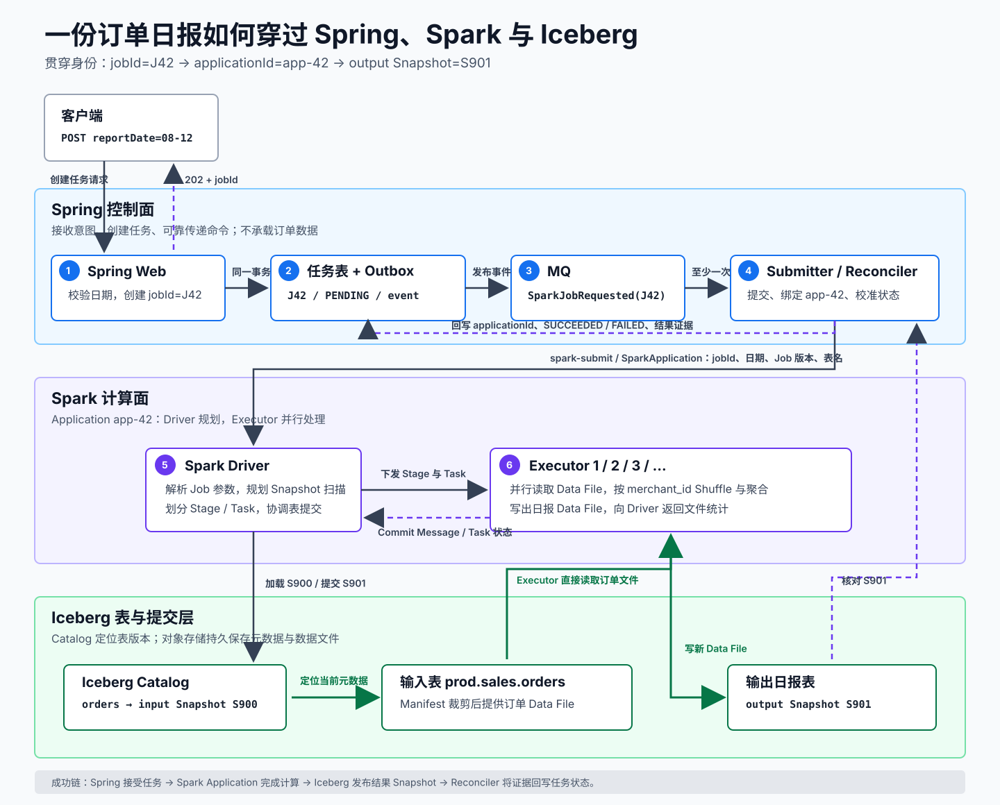

# 📌 Apache Spark：从一份日报到分布式数据任务

基础谈资。Apache Spark 是分布式计算引擎。它把一批数据拆成可并行的 Task，交给集群中的 Executor 执行，再把结果写回表或文件。

本教程面向熟悉 Java、Spring 和 MySQL，但没有大数据经验的后端工程师。学完后，你应该能够从一个 HTTP 请求出发，追踪 Spring 任务、Spark Application、Iceberg Snapshot 和最终报表之间的对应关系。

## 📄 贯穿教程的问题

产品需要一个“按日生成商户订单报表”的接口：

```http
POST /api/report-jobs
Content-Type: application/json

{"reportDate":"2026-08-12"}
```

订单已保存在 Iceberg 表 `prod.sales.orders`。单日数据达到数 TB，需要 Spark 并行过滤和聚合，再把结果写入 `prod.analytics.daily_order_report`。

整条链路回答五个问题：

1. Spark 如何把一份计算拆给多台机器？
2. Spark SQL 和 Java DataFrame 代码如何变成 Stage 与 Task？
3. Spark 从 Iceberg 读到的是哪一版表，写成功的标志又是什么？
4. Spring 如何发起、跟踪和取消一个运行数分钟的任务？
5. 重试、回调丢失、小文件和数据倾斜出现时，怎样定位责任层？

## 📄 三套系统怎样打通

Spring 服务体系运行**控制面**：接收意图、校验参数、记录任务、提交 Application 和对外返回状态。Spark 集群运行**计算面**：分配 Executor，并行读取、聚合和写文件。Iceberg 与 Catalog 组成**表与提交层**：选定输入 Snapshot，组织数据文件，并原子发布输出 Snapshot。

读图前先看计算面中的一个动作：订单分给多个 Executor 后，同一个 `merchant_id` 可能散落在不同输入分区。按商户汇总时，Spark 要把相同 `merchant_id` 的中间数据送到同一个后续分区。这个**按照 key 跨分区重新分布中间数据**的过程叫 **Shuffle**。图中的 Executor 会在聚合前完成这一步。

<div style="overflow-x: auto;">
  
</div>
[打开 SVG 原图](assets/spring-spark-iceberg-architecture.svg)

图中有三类不同的传递：

- **任务命令**：Spring 只传 `jobId`、日期、Job 版本和表名等小参数。
- **业务数据**：Executor 直接从 Iceberg 表对应的存储中并行读取，不经过 Spring HTTP 接口。
- **结果证据**：集群状态说明 Application 运行到哪一步；新 Iceberg Snapshot 说明这批表数据已经完整发布。

## 📄 学习路线

| 顺序 | 文档 | 学完后能回答 |
| --- | --- | --- |
| 0 | [先看懂 Spark 所在的数据系统](00-零基础前置课.md) | Spark、Iceberg、Catalog、存储和 Spring 分别管什么？ |
| 1 | [一条计算怎样拆成 Task](01-执行模型与-Shuffle.md) | Driver、Executor、Job、Stage、Task 如何连起来？ |
| 2 | [从 SQL 和 DataFrame 到执行计划](02-SQL-DataFrame-与惰性计算.md) | 为什么 `filter` 当场不读数据，`write` 才触发 Job？ |
| 3 | [Spark 怎样读写 Iceberg](03-Spark-与-Iceberg.md) | 输入 Snapshot、Data File、Commit Message 和输出 Snapshot 如何对应？ |
| 4 | [Spring 怎样控制 Spark 任务](04-Spring-异步任务体系.md) | HTTP、任务表、Outbox、Submitter 和 Application 怎样打通？ |
| 5 | [按日订单报表端到端实现](05-端到端实现.md) | 如何用 Java Job 读取订单并幂等地覆盖日报分区？ |
| 6 | [可靠性、运维与排查](06-可靠性与生产排查.md) | 任务卡住、重复提交、数据倾斜或小文件时怎样定位？ |
| 7 | [端到端综合复述](07-综合复述.md) | 能否脱离原文，串起 Spring、Spark、Iceberg 与结果证据？ |

第一遍按 `00` 到 `06` 阅读，再用 `07` 做闭卷复述。已经熟悉 Spark 执行模型时，可以从 `03` 开始专门学习 Iceberg 与 Spring 集成。

## 📄 贯穿数据模型

输入表 `prod.sales.orders`：

| order_id | merchant_id | amount | created_at |
| --- | --- | ---: | --- |
| O1001 | M01 | 80.00 | 2026-08-12 09:10:00 |
| O1002 | M01 | 20.00 | 2026-08-12 10:30:00 |
| O1003 | M02 | 45.00 | 2026-08-12 11:15:00 |

输出表 `prod.analytics.daily_order_report`：

| report_date | merchant_id | order_count | total_amount |
| --- | --- | ---: | ---: |
| 2026-08-12 | M01 | 2 | 100.00 |
| 2026-08-12 | M02 | 1 | 45.00 |

日期范围、表名和 Job 版本是控制参数。三条订单以及生产中的数 TB 数据都由 Spark Executor 直接读取。

## 📄 学习验收

完成教程后，不看原文画出下面两条链：

```text
计算链：SQL / DataFrame -> Action -> Job -> Stage -> Task -> Executor
业务链：HTTP -> jobId -> applicationId -> input Snapshot -> output Snapshot
```

然后回答：

1. `POST` 返回 `202` 时，哪些事已经发生，哪些还没发生？
2. Executor 写完 Parquet 后 Driver 立即退出，这份报表是否已对新查询可见？
3. 同一 `jobId` 被 MQ 投递两次，哪三层需要防止重复结果？

## 🌳 生长思考

> ⚠️ 此板块由用户本人填写，AI 创建笔记时只保留占位，不填充具体内容。

## 💭 反复绊脚

> ⚠️ 此板块由用户本人填写，AI 创建笔记时只保留占位，不填充具体内容。

## 🗺️ 修订记录

- 2026-08-13：吸收原 `Spark.md` 的执行模型、Iceberg 读写、Spring 异步任务、状态回写和生产排查主题，重组为费曼学习路线。
- 2026-08-13：按技术学习模板补齐各篇沉淀区，将反复困惑内聚到负责解释该概念的章节。
- 2026-08-13：在总览图首次需要 Shuffle 时，沿订单聚合过程就地解释该术语。

## 🛠️ 实践经历

## ⚙️ prompt

## 调研

- [Apache Spark Documentation](https://spark.apache.org/docs/latest/)
- [Spark SQL, DataFrames and Datasets Guide](https://spark.apache.org/docs/latest/sql-programming-guide.html)
- [Submitting Applications](https://spark.apache.org/docs/latest/submitting-applications.html)
- [Apache Iceberg Spark](https://iceberg.apache.org/docs/latest/spark-getting-started/)
- [Spring Transaction-bound Events](https://docs.spring.io/spring-framework/reference/data-access/transaction/event.html)
