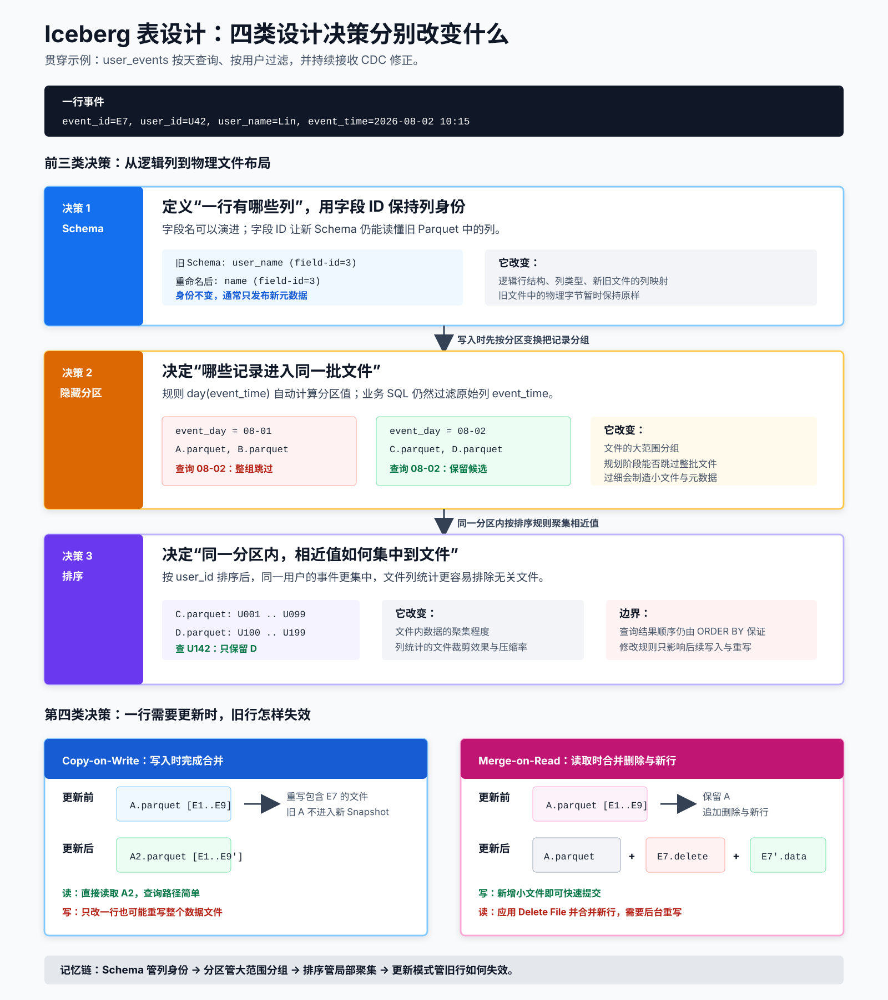

# 📌 Iceberg 表设计与数据变更

Iceberg 的 Schema、分区和排序是三类不同的设计：Schema 说明“列是什么”，分区决定“文件如何按变换组织”，排序影响“文件内部数据如何布置”。行级更新又是另一条路径：它要么重写 Data File，要么通过 Delete File 在读取时合并。



图的上半部分沿着一行数据的写入路径，展示 Schema、分区和排序分别作用在哪一层；下半部分展示同一行更新在 Copy-on-Write 与 Merge-on-Read 下产生的不同文件。

## 📄 这一篇要解决什么问题

`user_events` 刚建表时每天只有 1 GB，后来每天增长到 2 TB；`user_name` 要改名为 `name`；查询从“按天统计”变成“按用户查近七天”；CDC 还会不断修正旧事件。

这些变化分别在问四件不同的事：

1. **Schema**：一行数据有哪些字段，字段是什么类型？
2. **分区**：哪些记录倾向于进入同一批文件，从而先排除整批文件？
3. **排序**：一个分区或文件内部，哪些值尽量放在一起？
4. **更新模式**：旧行不再有效时，是重写文件，还是另写删除说明？

设计时分别评估这四类设计决策，因为它们改变表的不同层次。

## 📄 先看一张完整的表定义

下面使用 **Spark SQL 方言**。Spark 解析 `CREATE TABLE`，Iceberg Runtime 再把 Schema、分区规则和表属性写入 Iceberg 元数据。它与 MySQL DDL 的关系见 [SQL、方言与 Iceberg 的关系](00-零基础前置课.md#-sql方言与-iceberg-的关系)。

```sql
CREATE TABLE prod.analytics.user_events (
    event_id    BIGINT NOT NULL,
    user_id     BIGINT,
    user_name   STRING,
    event_type  STRING,
    event_time  TIMESTAMP,
    payload     STRING
)
USING iceberg
PARTITIONED BY (
    days(event_time),
    bucket(16, user_id)
)
TBLPROPERTIES (
    'format-version' = '2',
    'write.format.default' = 'parquet',
    'write.target-file-size-bytes' = '536870912',
    'write.delete.mode' = 'merge-on-read',
    'write.update.mode' = 'merge-on-read',
    'write.merge.mode' = 'merge-on-read'
);
```

| 语法位置 | 形成的表设计 |
| --- | --- |
| 字段列表 | Schema；字段 ID 由 Iceberg 分配和维护 |
| `USING iceberg` | 让 Spark 使用 Iceberg 表提供程序 |
| `days(event_time)` | Spark DDL 对 Iceberg `day` 分区变换的写法 |
| `bucket(16, user_id)` | 把 `user_id` 稳定映射到 16 个分区桶 |
| `format-version=2` | 让表采用支持 Delete File 的格式版本 |
| `write.format.default` | 新 Data File 默认写成 Parquet |
| `write.target-file-size-bytes` | 将 512 MiB 作为目标文件大小，实际结果还受任务数据量影响 |
| 三个 `write.*.mode` | 分别设置 `DELETE`、`UPDATE`、`MERGE` 的写入模式 |

排序规则在 Spark SQL 中可以单独设置：

```sql
ALTER TABLE prod.analytics.user_events
WRITE ORDERED BY user_id, event_time;
```

这份 DDL 把四类设计决策放在一起展示。后续章节再逐项解释每个选择会怎样影响元数据、文件布局和读写成本。不同 Spark、Iceberg 版本支持的语法和属性可能不同，使用前根据目标版本的官方文档和隔离表验证结果确认。

## 📄 用书架理解三种设计

| 表设计 | 书架类比 | 真正影响 |
| --- | --- | --- |
| Schema | 每本档案必须有哪些栏目 | 行的逻辑结构和新旧列映射 |
| 分区 | 先按年份把档案放到不同房间 | 规划时能否跳过一大批文件 |
| 排序 | 同一房间内再按姓名排列 | 相近值能否集中，统计信息能否排除更多文件 |

分区根据变换规则组织文件，排序让相近值集中存放。查询结果的输出顺序由显式 `ORDER BY` 保证；增加目录层数本身不会直接带来性能收益。

## 📄 Schema 演进

Iceberg 用稳定的字段 ID 识别列，而不只依赖列名或位置。因此添加列、重命名列、删除列和部分安全的类型扩宽可以只修改元数据，不立即重写旧文件。

字段 ID 可以理解为列的身份证号。名字可以从 `user_name` 改成 `name`，身份证号不变，读取器就知道旧文件的 `user_name` 与当前的 `name` 是同一列。若删除后再新建同名列，它会取得新 ID，语义上不再是原列。

字段 ID 是列的稳定身份。将 `user_name` 重命名为 `name` 时 ID 不变，旧文件中的原列仍能映射到新名称。新增的可选列在旧文件中没有字节，未设置列默认值时按 `null` 读取；v3 允许用初始默认值解释旧数据，但必须先验证所有引擎的兼容性。

### 🔖 Schema 变更规则

| 操作 | 是否通常只改元数据 | 需要额外注意 |
| --- | --- | --- |
| 增加可选列 | 是 | 旧文件读取为 `null` 或约定的初始默认值 |
| 重命名列 | 是 | 使用重命名操作保留原字段 ID |
| 删除列 | 是，但旧字节可能仍存在 | 合规擦除要重写数据并清理可引用旧快照 |
| 安全类型扩宽 | 通常是 | 先核对所有引擎和文件格式的支持 |
| 改变字段含义 | 通常需要数据迁移 | 使用新列或版本化业务语义 |

操作要点：

- 重命名或修改类型时使用 Iceberg 对应的 Schema 演进操作，以保留字段 ID；删除后再添加的同名列会获得新 ID。
- 先检查所有读写引擎是否支持目标类型和演进操作。
- Schema 删除先改变表级元数据，旧 Data File 中的物理字节保留到相关 Snapshot 过期并完成文件清理。
- 合规擦除需要重写受影响 Data File，并清理仍可引用旧文件的快照、分支和标签。

## 📄 隐藏分区

分区变换是从业务列计算分区值的规则，例如 `day(event_time)` 和 `bucket(16, user_id)`。“隐藏分区”表示分区值由 Iceberg 根据业务列自动计算和管理，业务 SQL 直接使用 `event_time`、`user_id` 等原始列。

建表时定义 `day(event_time)` 后，查询仍然写业务列：

```sql
WHERE event_time >= TIMESTAMP '2026-08-01 00:00:00'
  AND event_time <  TIMESTAMP '2026-08-02 00:00:00'
```

Iceberg 会根据分区变换自动推导要读取的分区。分区是裁剪候选文件的第一层线索，列统计和文件布局仍会影响最终扫描量。

### 🔖 分区变换选择

| 查询特征 | 候选变换 | 设计注意 |
| --- | --- | --- |
| 按事件时间查最近几天 | `day(event_time)` | 默认从天级开始，数据量足够大再考虑 `hour` |
| 按高基数 ID 等值查 | `bucket(N, user_id)` | N 要结合数据量、并行度和目标文件大小验证 |
| 按有限地域或类型过滤 | identity 分区 | 检查值域和倾斜，避免碎分区 |
| 按字符串前缀或数值区间查 | `truncate(L, col)` | 用于扩大同类值的聚集并辅助文件裁剪 |

分区设计从主要查询条件、单分区数据量和写入并行度出发。分区过细会产生小文件、Manifest 膨胀和调度开销；分区过粗则会使文件裁剪收益不足。Hive 时代已有的多层目录方案需要按这三项重新评估。

**高基数**表示不同值非常多，例如亿级用户 ID；**数据倾斜**表示少数分区承载了远多于其他分区的数据。高基数列直接使用 identity 分区，可能制造海量小分区；低基数但严重倾斜的列，也可能让某一个分区过大。

`bucket(16, user_id)` 会对 `user_id` 做稳定哈希并映射到 16 个桶，让相同值落到同一分区桶，帮助等值条件缩小候选范围。一个桶可以包含许多用户和文件，因此它提供分区裁剪能力，粒度比数据库主键索引更粗。

## 📄 分区与排序演进

- 修改分区规则后，旧文件保持原布局，新数据使用新规则；查询规划会分别按各版本 Partition Spec 裁剪文件。
- 修改排序规则后，新写文件使用新布局。历史数据可在后续重写时转换为新布局。
- 元数据演进定义后续写入规则，数据重写调整历史数据的物理布局。

排序规则表达写入引擎应如何布置新数据，相近值集中存放后有利于列统计裁剪和压缩。它影响文件布局；查询结果的输出顺序仍由 `ORDER BY` 指定。

## 📄 行级更新：Copy-on-Write 与 Merge-on-Read

Iceberg 表格式 v2 支持行级 `DELETE`、`UPDATE` 和 `MERGE` 所需的删除表达。实际能否执行及采用哪种方式，由计算引擎和表属性共同决定。

Data File 通常按不可变文件处理。行级更新要么重写受影响的 Data File，要么写入删除表达，并在更新场景中另写一份新行。

| Delete File 类型 | 记录内容 | 直观理解 |
| --- | --- | --- |
| Position Delete | 数据文件路径加行位置 | “A.parquet 的第 N 行不再可见” |
| Equality Delete | 一组字段 ID 及其值 | “等值匹配这组值的旧行不再可见” |

读取引擎会结合 data sequence number 判断 Delete File 应作用于哪些 Data File，避免新写入的同值行被旧删除记录误伤。这些删除记录最终由读引擎合并为正确的表视图。

**Sequence number（序列号）**记录数据或删除变化在表提交历史中的先后。删除文件按照序列号作用于规则允许的较早数据文件，从而保护后来写入的同值行。初学时先记住“删除也有生效时间”，序列号由 Iceberg 维护。

### 🔖 两种写入模式

| 模式 | 写入方式 | 优势 | 代价 | 更适合 |
| --- | --- | --- | --- | --- |
| Copy-on-Write | 重写包含受影响行的数据文件 | 查询简单、读性能稳定 | 频繁小范围更新会放大写 I/O | 读多写少、批量修正 |
| Merge-on-Read | 保留数据文件，另写 Delete File | 更新提交更快 | 查询时合并删除，需要定期合并 | 变更频繁且能承担后台维护 |

### 🔖 怎么选更新模式

- Merge-on-Read 的选型条件包括主要读引擎对 Delete File 的支持、读时合并成本和后台重写周期。
- CDC（Change Data Capture）有大量小批次 upsert 时，把实时性、小文件和后台合并作为一组参数调整。
- `MERGE INTO` 前保证源数据对每个目标键至多匹配一行，否则 Spark 可能报错。
- 生产上显式设定 `write.delete.mode`、`write.update.mode` 和 `write.merge.mode`，并把参数值纳入版本配置。

`MERGE INTO ... ON target.event_id = source.event_id` 把 `event_id` 作为本次计算的匹配条件。业务唯一性通过上游去重、质量校验或版本序号维护；Iceberg Schema 中的字段定义与 `NOT NULL` 约束用于行结构和空值校验。

## 📄 例：按天查询的事件表

假设 `user_events` 主要按天查询、每天追加写入，偶尔由 CDC 修正近七天数据：

1. 用 `day(event_time)` 作为起点，避免为每个小时制造过多分区。
2. 以 Parquet 和接近 512 MiB 的目标文件大小做基线，再用实际任务调优。
3. 读多写少的历史修正使用 Copy-on-Write；小批次实时变更才评估 Merge-on-Read。
4. 为 `event_id` 做 `MERGE` 匹配，但通过上游去重或质量任务保证业务唯一性。
5. 设定 Delete File 合并、快照保留和孤儿文件清理的维护窗口。

### 🔖 先预测再设计

假设每天只有 200 MB 数据，却按 `hour(event_time), bucket(128, user_id)` 分区。一天理论上会出现最多 `24 × 128 = 3072` 个分区组合，许多组合的数据极少。即使总数据不大，也可能产生大量小文件和元数据。

这个例子说明分区粒度需要匹配实际数据量。合理的推导顺序是：

```text
主要过滤条件
  -> 每个候选分区大约有多少数据
  -> 写入任务能否形成大小适中的文件
  -> 实测裁剪收益和规划成本
```

最终 bucket 数量由自己的数据量、查询条件、写入并行度和实测结果确定。

## 📄 小结

- Schema 说明列，分区决定文件如何组织，排序影响文件内的数据布局。
- 分区变换从主要查询条件、分区数据量和写入并行度出发。
- Copy-on-Write 和 Merge-on-Read 是两种更新路径，业务主键唯一性由上游去重与质量规则维护。
- 元数据演进改变后续写入规则；历史文件要获得新布局，仍需重写。

## 📄 自测与费曼复述

1. 列改名为什么可以不重写旧 Parquet？
2. 从 `day(event_time)` 改成 `month(event_time)` 后，旧文件会自动移动吗？
3. 排序规则与 SQL 的 `ORDER BY` 分别控制什么？
4. Merge-on-Read 为什么写得快，却可能让查询变慢？
5. `bucket(16, user_id)` 与主键索引的粒度有什么区别？

用 `user_events` 向同事解释上述问题，并画出 Copy-on-Write 与 Merge-on-Read 各自新产生什么文件。说不清时，回到“Schema 管含义、分区管大范围分组、排序管局部布局、更新模式管旧行如何失效”这四句话。

## 🌳 生长思考

> ⚠️ 此板块由用户本人填写，AI 创建笔记时只保留占位，不填充具体内容。

## 💭 反复绊脚

> Schema、分区与排序演进的问答见 [07-常见问题](07-常见问题.md)。

## 🗺️ 修订记录

- 2026-08-13：增加 Spark SQL 完整建表定义，并把 DDL 逐项映射到四类表设计决策。
- 2026-08-12：增加贯穿场景、书架类比、高基数/倾斜/桶/序列号解释、反例推导和自测。
- 2026-08-06：从 Iceberg 主笔记拆出 Schema、隐藏分区、排序演进和行级更新，并按各机制的工作方式组织设计要点。

## 🛠️ 实践经历

## ⚙️ prompt

## 调研

- [Evolution](https://iceberg.apache.org/docs/latest/evolution/)
- [Partitioning](https://iceberg.apache.org/docs/latest/partitioning/)
- [Table Spec: Row-level Deletes](https://iceberg.apache.org/spec/#row-level-deletes)

---

[上一篇：元数据与事务原理](02-元数据与事务原理.md) | [返回 Iceberg 目录](README.md) | [下一篇：Spark SQL 实战](04-Spark-SQL实战.md)
