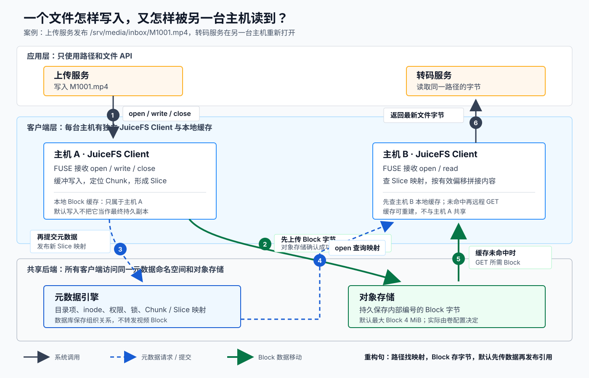

# 📌 一次读写怎样穿过 JuiceFS

上传服务完成 `/srv/media/inbox/M1001.mp4` 后，另一台主机上的转码服务重新打开这个路径。两台机器没有共享本地磁盘，却能通过同一个元数据引擎和对象存储看见同一文件。

学完本篇，你应该能从路径解析一路追踪到对象存储 Block，并解释默认写入顺序为什么能避免其他客户端读到尚未上传的数据。

## 📄 四个协作方

这张图回答：**应用写入 `M1001.mp4` 后，路径信息和文件字节分别经过哪里，另一台客户端又怎样读回？**

<div style="overflow-x: auto;">
  
</div>

[打开 SVG 原图](assets/juicefs-read-write-path.svg)

图中的三类线传递不同内容：

- **文件请求**：`open/write/close` 等系统调用，从应用穿过内核 FUSE 到客户端。
- **元数据请求**：目录项、inode、权限和 Chunk/Slice 映射，由客户端读写元数据引擎。
- **Block 数据**：文件字节在客户端、本地缓存和对象存储之间移动，不经过元数据引擎。

## 📄 写入路径

默认模式下，上传服务连续写入文件的大致过程是：

1. 应用调用 `open`，内核把请求交给挂载点对应的 JuiceFS Client。
2. 客户端向元数据引擎创建目录项和 inode，并校验权限。
3. `write` 先把字节放入客户端内存缓冲，文件偏移决定它属于哪个 Chunk。
4. 客户端把连续写入表示为 Slice，再把 Slice 拆成 Block，并行上传到对象存储。
5. Block 上传成功后，客户端向元数据引擎提交 Slice 与 Block 的映射。
6. `flush`、`fsync` 或 `close` 推进未完成写入；调用者必须检查这些操作返回的错误。

第 4、5 步的顺序是可靠性关键：默认模式先确认数据在对象存储，再发布引用它的元数据。元数据提交失败时，其他客户端不会通过有效文件映射读到这批未提交 Block；这些 Block 可能成为待后台清理或维护工具识别的对象。

## 📄 Chunk、Slice 与 Block

### 🔖 Chunk：按文件偏移定位

JuiceFS 把每个文件按固定偏移范围划分为 Chunk，每个 Chunk 最大 64 MiB。一个连续写入的 160 MiB 原片会覆盖三个 Chunk：

| Chunk 索引 | 文件偏移范围 | 本次连续写入 |
| --- | --- | --- |
| 0 | 0～64 MiB | Slice A |
| 1 | 64～128 MiB | Slice B |
| 2 | 128～160 MiB | Slice C |

Chunk 是逻辑定位单位。只要文件长度不变，某个偏移属于哪个 Chunk 就是稳定的。

### 🔖 Slice：记录一次连续写入

Slice 表示落在同一 Chunk 内的一次连续写入。转码工具后来覆盖 70～71 MiB，这次写入落在 Chunk 1，并形成一个新的 Slice D。旧 Slice B 仍可能暂时存在；读取 70～71 MiB 时使用更新的 Slice D，其他范围仍由 Slice B 提供。

反复覆盖同一范围会积累重叠 Slice，增加查找和空间成本。JuiceFS Client 会评估碎片并异步压实同一 Chunk 内的 Slice。

### 🔖 Block：对象存储中的物理单位

Slice 在持久化时继续拆成 Block。默认最大 Block 大小是 4 MiB，实际值由格式化时的文件系统配置决定。Block 是对象存储和本地磁盘缓存处理的最小数据单元。

因此，对象存储中看到的是内部编号的 Block，不是原始路径名对应的完整视频对象。元数据引擎保存下面这层映射：

```text
/inbox/M1001.mp4 -> inode -> Chunk 1 -> Slice B + Slice D -> 若干 Block
```

## 📄 读取路径

转码服务第一次读取文件时：

1. `open` 经 FUSE 到达本机 JuiceFS Client。
2. 客户端查询元数据引擎，解析路径、权限、文件属性和 Slice 映射。
3. `read(offset, length)` 被定位到一个或多个 Block。
4. 客户端依次利用内核页缓存、进程缓冲和本地磁盘缓存；未命中时请求对象存储。
5. 客户端按 Slice 的有效偏移范围拼出最新文件内容并返回应用。

第二次读取相同范围时，本地缓存可能命中，因此延迟与吞吐会明显好于首次读取。性能测试必须区分冷读和热读。

## 📄 默认可见性

JuiceFS 默认提供 close-to-open 一致性：客户端 A 修改并关闭文件后，客户端 B 再次 `open` 时会查询最新状态并看见变化。内核元数据缓存默认会引入短 TTL；同一个仍然打开的文件以及主动调大的缓存参数存在更具体的语义。

这条保证描述的是“关闭后重新打开”的观察点。应用需要把完整文件作为一个发布单元时，可以先写临时路径，再使用 `rename` 切换到正式路径：

```text
写 /output/.M1001-720p.mp4.tmp
fsync + close
rename -> /output/M1001-720p.mp4
```

这样，审核服务通过正式路径看见的是切换前版本或切换后版本，而不是依赖它猜测写入是否结束。应用仍要处理失败重试和同名发布冲突。

## 📄 故障落在哪一层

| 现象 | 优先检查 | 原因 |
| --- | --- | --- |
| `ls`、`stat`、`open` 普遍慢 | 元数据引擎与元数据缓存 | 这些操作主要处理目录和属性 |
| 路径查找快，冷读大文件慢 | 对象存储、网络与预读 | 元数据已解析，数据远程获取慢 |
| 热读快、冷读慢 | 本地缓存命中率与对象存储 | 两次读取走了不同数据路径 |
| 单台主机异常，其他挂载正常 | 本机客户端、FUSE、缓存盘 | 共享后端仍可由其他客户端访问 |
| 所有客户端都无法看到目录变化 | 元数据引擎或共享网络 | 目录树的权威状态无法访问 |

## 📄 先预测

上传一个 160 MiB 文件时，对象存储一定只产生 40 个 4 MiB Block 吗？

答案是不一定。4 MiB 是默认最大 Block 大小；最后一个 Block 可以更小，flush 边界、非连续写入和配置也会影响实际对象数量。若只用 `160 / 4` 得到固定答案，回到“Chunk、Slice 与 Block”，区分逻辑上限与实际写入形状。

改变条件：对 70～71 MiB 重写 1 MiB。系统不需要重写整个 160 MiB 文件；它记录新 Slice 和相应 Block，读取时组合最新有效范围，后续再异步处理碎片。

## 📄 费曼复述

合上本篇，用不超过 120 字向只用过本地磁盘的同事解释：

> 为什么对象存储里没有 `M1001.mp4`，JuiceFS 却能按这个名字读取完整视频？

答案至少应包含路径/inode、Chunk/Slice 映射、Block 和对象存储。若说不清“修改中间 1 MiB 后怎样读到最新内容”，回到 Slice 小节重新推演。

---

[上一篇：零基础前置课](00-零基础前置课.md) | [返回 JuiceFS 目录](README.md) | [下一篇：本地动手实验](02-本地动手实验.md)

## 🌳 生长思考

> ⚠️ 此板块由用户本人填写，AI 创建笔记时只保留占位，不填充具体内容。

## 💭 反复绊脚

> ⚠️ 此板块由用户本人填写，AI 创建笔记时只保留占位，不填充具体内容。

## 🗺️ 修订记录

- 2026-08-27：建立 JuiceFS 默认读写链与 Chunk、Slice、Block 模型。

## 🛠️ 实践经历

## ⚙️ prompt

## 调研

- [JuiceFS Architecture](https://juicefs.com/docs/community/architecture)
- [Cache](https://juicefs.com/docs/community/guide/cache)
